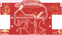
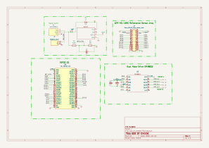

# Line Follower Robot v2 · God of Cheese

Line follower robot hardware for **ROBOTEC UPT 2027**. This repository contains the **God of Cheese** KiCad project, its custom libraries, mechanical models, and existing fabrication exports.

The design includes an **ESP32-S3**, a **DRV8833** motor driver, a buck converter, battery connection, slide switch, and motor/sensor connections. Firmware is not included in this repository.

## PCB

| Front | Back (mirrored) |
| :---: | :---: |
|  |  |

These previews are generated from the committed PCB and show copper, silkscreen, and board outline.

## Schematic

[View or download the schematic PDF](docs/schematic.pdf).

## Open the project

1. Clone or download the entire repository.
2. Install **KiCad 10.0 or newer** with its standard symbol, footprint, and 3D model libraries.
3. Open [`God_of_cheeseLFR.kicad_pro`](God_of_cheeseLFR.kicad_pro) in the KiCad Project Manager.
4. Open the schematic or PCB from that project.

Designed in **KiCad 10.0**. Project-specific libraries use `${KIPRJMOD}` paths so the project can be opened from a different computer.

## Repository contents

| Path | Contents |
| --- | --- |
| `God_of_cheeseLFR.kicad_pro` | Main project and design settings |
| `God_of_cheeseLFR.kicad_sch` | Circuit schematic |
| `God_of_cheeseLFR.kicad_pcb` | Two-layer PCB layout |
| `*.pretty/` | Custom footprints, including board artwork |
| `symbols/` | Custom symbol libraries recovered from the schematic's embedded symbols |
| `3dmodels/` | STEP, STL, and SolidWorks mechanical assets |
| `fp-lib-table`, `sym-lib-table` | Portable project library tables |
| `docs/` | PCB previews, schematic PDF, and validation reports |
| `production/` | Existing Gerber archive, BOM, positions, designators, and IPC netlist |
| `Gerber/Savitar_V1/` | Legacy Savitar fabrication outputs |
| `Savitar_LFR.kicad_pro` | Legacy project settings retained from the source folder |

## Design status

This is a hardware design snapshot. See [the validation notes](docs/validation.md) for checks run before publication and the outstanding findings.

The files in `production/` and `Gerber/` are preserved exports supplied with the project; they were **not regenerated** for this upload and their correspondence to the current PCB has not been established. Review the current design and regenerate fabrication outputs before ordering boards. Some BOM entries still contain generic values and empty supplier part numbers.

Local backups, autosaves, editor history, caches, locks, and per-user KiCad settings are excluded from version control.
